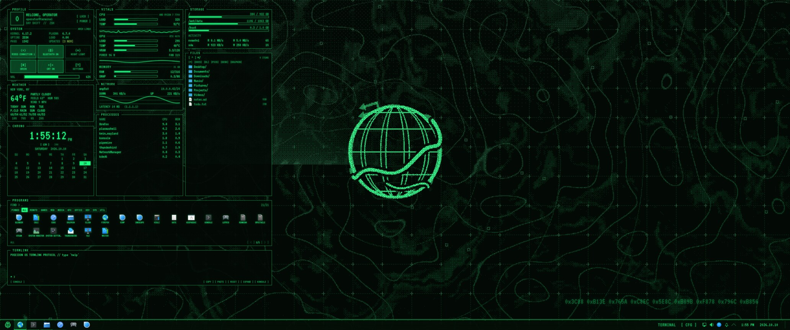
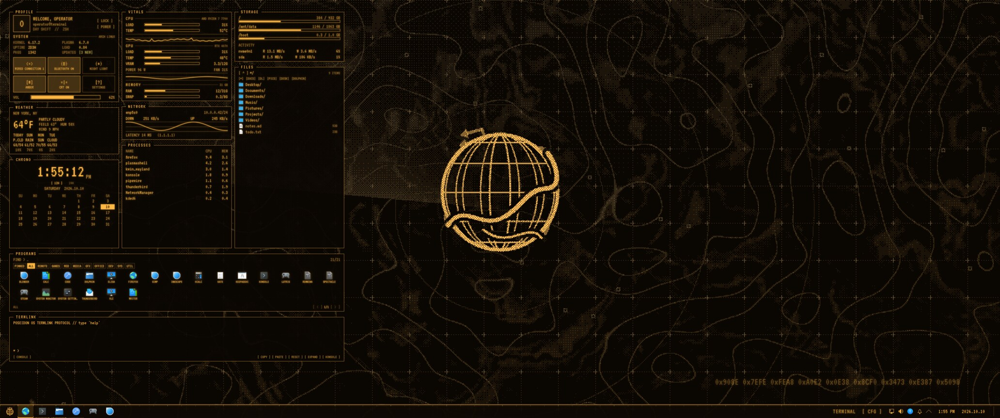
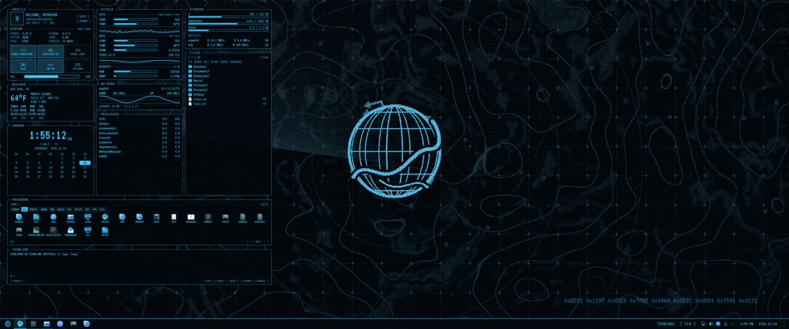

# PoseidonOS

A phosphor-terminal theme for KDE Plasma 6, styled after old green-screen computer terminals.

- Green, amber or blue phosphor colour schemes, switchable at any time
- Matching window frames, Plasma style and Konsole profiles
- An animated, dithered wasteland-map wallpaper
- A desktop HUD with system stats, weather, a file browser, an app launcher and a terminal
- An optional CRT scanline overlay



| Amber | Blue |
|---|---|
|  |  |

*Previews rendered from the theme's own code with sample data: the user, stats and location are made up.*

Everything lives in [`poseidonos/`](poseidonos/README.md). Start there for
requirements, installation and usage.

```bash
git clone https://github.com/devbnkdr/PoseidonOS.git
cd PoseidonOS/poseidonos
./install.sh
```

The installer backs up your current desktop first, and `./uninstall.sh` puts it back.

## No warranty

PoseidonOS is provided as is, without any warranty, and you use it at your own risk. It changes
your desktop settings; the installer backs them up first and `uninstall.sh` restores them, but
keep your own backups too. To the extent the law allows, the author is not liable for any damage
or data loss resulting from its use. See sections 15 and 16 of the [license](LICENSE) for the full terms.

## License

Copyright © 2026 devbnkdr. PoseidonOS is free software, released under the
[GNU General Public License v3.0](LICENSE). You can use, study, change and share it; if you
distribute a modified version, it has to stay under the GPL with its source available.

If you want to use it under other terms, for example inside a closed-source product, a separate
commercial license is available. Get in touch through GitHub.

The bundled fonts are under the SIL Open Font License 1.1.
