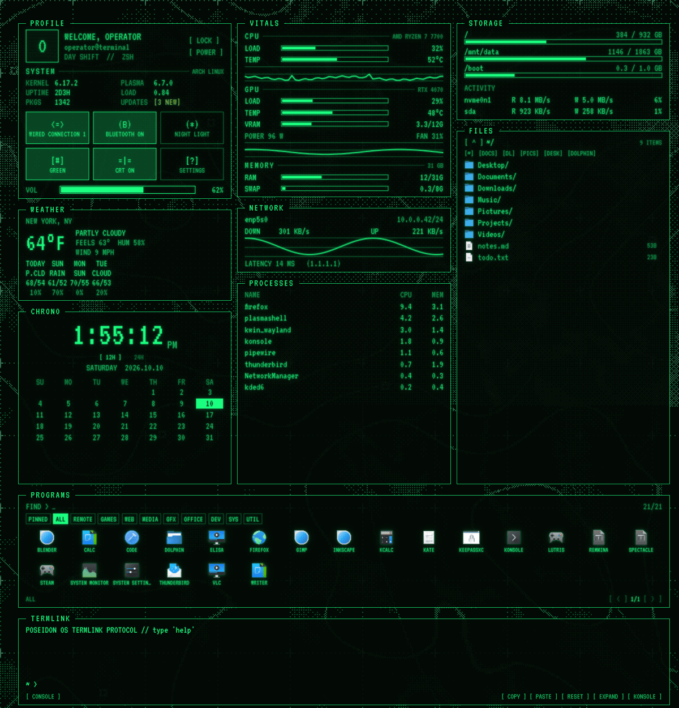

# PoseidonOS

A phosphor-terminal theme for KDE Plasma 6, styled after old green-screen computer terminals.
It covers the colour scheme, window frames, the panel, an animated dithered wallpaper, a desktop
HUD with live system info, a built-in terminal and an optional CRT scanline overlay.
Green, amber or blue phosphor, switchable at any time.


The HUD up close:



*Previews rendered from the theme's own code with sample data: the user, stats and location are made up.*

## Requirements

- KDE Plasma 6 (tested on 6.7 with Qt 6.11), X11 or Wayland
- `qt6-declarative` and `python3`
- `kwriteconfig6`, `plasma-apply-colorscheme` and `plasma-apply-lookandfeel`, which come with Plasma

Package names below are for Arch. Other distros work too; use your own package names.

Optional extras, each one turns on a feature:

| Package | Adds |
|---|---|
| `qmltermwidget` | a real interactive shell in the TERMLINK panel (otherwise you get a simple built-in console) |
| `playerctl` | the RADIO now-playing panel |
| `pacman-contrib` | the pending-updates count |
| `layer-shell-qt` | the CRT overlay on Wayland (not needed on X11) |
| `nvidia-utils` | GPU stats on NVIDIA cards (AMD cards are read directly) |

## Install

```bash
git clone https://github.com/devbnkdr/PoseidonOS.git
cd PoseidonOS/poseidonos
./install.sh
```

Log out and back in once when it finishes.

Options:

```bash
./install.sh amber          # start in amber (green, amber or blue)
./install.sh --keep-layout  # keep your current panels and widgets, only apply the look
./install.sh --no-crt       # don't start the CRT overlay
./install.sh --panels dodge # taskbar behaviour: always, dodge, auto or below
```

The installer backs up your current desktop before it changes anything. Your settings are saved to
`~/.local/share/poseidonos/backup-<date>/`, and a full snapshot of your panels, widgets
and theme files goes in a `desktop-backup-<date>.tar.gz` next to this folder.

### Update

```bash
git pull
./update.sh
```

This refreshes the widgets, wallpaper, scripts and styles and restarts the Plasma shell. Your panel
layout, widget positions and settings stay as they are.

### Uninstall

```bash
./uninstall.sh          # remove the theme and restore the settings you had before installing
./restore-desktop.sh    # or put back the full desktop snapshot taken at install time
```

`restore-desktop.sh` uses the oldest snapshot by default. Pass a file name to pick another one.

## Using it

### The [ CFG ] button

Click `[ CFG ]` on the taskbar for the settings popup:

- **Phosphor**: green, amber or blue. Widgets, window frames, Konsole and the wallpaper all follow it.
- **Clock**: 12 or 24 hour, for both the taskbar clock and the HUD.
- **CRT overlay**: on or off, plus scanline strength, vignette, the rolling band and flicker.
- **Wallpaper**: wasteland map or plain flow style, animation, speed, dot size, brightness, detail,
  frame rate, and the emblem (on/off, size, or your own PNG/SVG).
- **Weather**: set a location by US ZIP code or city name, and pick °F or °C.

### The taskbar

There is one bar, at the bottom. From left to right: the PoseidonOS emblem (click it for the
app menu), your pinned and running apps, then `TERMINAL` (opens Konsole), `[ CFG ]`, the system
tray, the clock and show-desktop. The active app gets terminal-style brackets, other running apps
a dashed underline, minimised ones a dotted one.

The bar artwork is generated by `plasma/desktoptheme/build-bar-svgs.py`. If the widgets on the bar
get out of order, `poseidonos-panels arrange` puts them back. You can add more buttons next to
`TERMINAL` in that widget's settings, one per line, as `LABEL:hint|command`.

By default the bar is always visible and maximised windows stop above it. To change that:

```bash
poseidonos-panels status    # what the bar is doing now
poseidonos-panels always    # always visible (default)
poseidonos-panels dodge     # hides when a window overlaps it
poseidonos-panels auto      # always hidden until you push the mouse against the edge
poseidonos-panels below     # see the note below
```

**Meta+Shift+B** switches between `always` and the last hiding mode you used. Your choice is saved
and re-applied if you run `install.sh` again.

A note on `below`: Plasma calls it "Windows Go Below", but it actually lets windows extend *under*
the bar, which keeps drawing on top of them. Anything at the bottom of a maximised window ends up
hidden behind the bar. If you want the bar to get out of the way, use `dodge`.

**If the bar gets stuck on top of windows.** After a resolution or scaling change, a bar in `auto`
or `dodge` mode can stop hiding and sit on top of maximised and fullscreen windows. This is a
Plasma bug ([477810](https://bugs.kde.org/show_bug.cgi?id=477810),
[478256](https://bugs.kde.org/show_bug.cgi?id=478256)) and it is most common on X11 with monitors
at different resolutions. Run `poseidonos-panels kick` to restart the shell, which clears it.
`always` mode doesn't have this problem.

### The desktop HUD

The HUD runs down the left side of the desktop as a set of panels. It sizes itself to fit the
screen: on a smaller screen the text shrinks and the less important panels are hidden, so it never
needs a scrollbar.

| Panel | Shows |
|---|---|
| `PROFILE` | your avatar, user@host, kernel, Plasma version, uptime, load, package and update counts, lock and power buttons, quick toggles and volume |
| `WEATHER` | current conditions and a 4-day forecast ([Open-Meteo](https://open-meteo.com), no API key needed) |
| `VITALS` | CPU, GPU and memory: usage, temperature, history graphs |
| `STORAGE` | how full each disk is, plus read/write activity |
| `NETWORK` | download and upload rates, IP address, latency |
| `CHRONO` | a large clock and this month's calendar |
| `FILES` | a small file browser; `[DOLPHIN]` opens the current folder |
| `PROCESSES` | the busiest processes |
| `PROGRAMS` | all your installed apps, sorted into tabs (PINNED, ALL, REMOTE, AI, GAMES, WEB, MEDIA, GFX, OFFICE, DEV, SYS, UTIL), with a search box |
| `TERMLINK` | a terminal across the bottom |

`RADIO` (now playing) and `MEMO` (notes) are off by default. Add `media` or `notes` to the section
list in the HUD's settings (right-click → Configure) to turn them on. The same settings let you
reorder the panels and choose the columns.

### TERMLINK

With `qmltermwidget` installed this is a real shell. Without it, it's a simple console that runs
one command at a time. The buttons along the bottom: `[ SHELL ]`/`[ CONSOLE ]` switches between the
two, `[ COPY ]`, `[ PASTE ]` and `[ RESET ]` do what they say, `[ EXPAND ]` makes the terminal fill
the HUD, and `[ KONSOLE ]` opens a full Konsole window. Ctrl+Shift+C / Ctrl+Shift+V and
middle-click paste work too.

### Keyboard shortcuts

| Shortcut | Action |
|---|---|
| Meta+Shift+C | CRT overlay on/off |
| Meta+Shift+P | next phosphor colour |
| Meta+Shift+B | taskbar always visible / out of the way |

### Command line

The installer puts these in `~/.local/bin`:

```bash
poseidonos-theme green|amber|blue|toggle    # switch phosphor colour
poseidonos-crt start|stop|toggle|status     # CRT overlay
poseidonos-crt disable                      # stop it and keep it off at login
poseidonos-panels always|dodge|auto|below   # taskbar behaviour (see above)
poseidonos-clock 12|24                      # clock format
poseidonos-pins [fix]                       # apps that open beside their pinned button instead of on it
poseidonos-stats sys|procs|info|profile     # the JSON the HUD reads, handy for debugging
```

## Where things are installed

| Path | What |
|---|---|
| `~/.local/bin/poseidonos-*` | helper scripts |
| `~/.local/share/plasma/plasmoids/com.poseidonos.*` | the HUD, `[ CFG ]` and taskbar tab widgets |
| `~/.local/share/plasma/wallpapers/com.poseidonos.wallpaper` | the animated wallpaper |
| `~/.local/share/plasma/desktoptheme/poseidonos` | the Plasma style |
| `~/.local/share/plasma/look-and-feel/com.poseidonos.desktop` | the global theme and splash screen |
| `~/.local/share/aurorae/themes/PoseidonOS-*` | window frames |
| `~/.local/share/color-schemes/PoseidonOS*.colors` | colour schemes |
| `~/.local/share/konsole/PoseidonOS-*` | Konsole profiles |
| `~/.local/share/icons/hicolor/scalable/apps/poseidonos-emblem-symbolic.svg` | the launcher emblem |
| `~/.local/share/fonts/poseidonos` | VT323 and Share Tech Mono |
| `~/.local/share/poseidonos/` | CRT overlay files, logs and backups |
| `~/.config/poseidonos/` | your settings (`desktop.json`, `crt.conf`, `variant`, `panels`) |

## Troubleshooting

Start with `./diagnose.sh`. It writes a `diag.txt` next to this folder with your session type, the
installed files, the CRT log, recent crashes and the relevant part of the Plasma log. Attach it if
you open an issue.

**The CRT overlay won't start on Wayland.** Install `layer-shell-qt`. Without it the overlay doesn't
start at all, because the fallback would leave empty windows in your taskbar and app switcher. The
reason is logged in `~/.local/share/poseidonos/poseidonos-crt.log`.

**Text in the popups is garbled.** The font cache is stale. Run `./fix-fonts.sh`.

**The Plasma style looks like plain Breeze.** Run
`kwriteconfig6 --file plasmarc --group Theme --key name poseidonos` and restart the shell.

**A pinned app gets a second button when it opens.** Common with Wine and Bottles apps. Plasma can
only put a window on its pin when the shortcut's `StartupWMClass` matches the window. With the app
open, run `poseidonos-pins` to see what doesn't match, then `poseidonos-pins fix` to fix it.
Shortcuts are backed up first. You may need to reopen the app afterwards.

**Konsole colours didn't change.** Open tabs only switch live if `qdbus6` is installed; otherwise
new tabs pick up the new colour.

**You want everything back the way it was.** `./restore-desktop.sh`.

## Known issues

- **X11 with the NVIDIA driver:** every change of window frame makes KWin rebuild its GL state,
  and some GL apps (Electron apps especially) can crash when that happens. The theme only does this
  when the frame actually changes, but avoid switching phosphor colours rapidly on that setup.
  Wayland isn't affected.
- **Mixed-DPI monitors:** the CRT overlay draws one surface per screen, so the scanline spacing can
  look different from one screen to the next.

## Editing the shaders

The wallpaper's shaders are compiled. After changing `flow.frag` or `noise.frag`, rebuild the
matching `.qsb` file with Qt's `qsb` tool, for example:

```bash
qsb --glsl "100es,120,150" --hlsl 50 --msl 12 -o flow.frag.qsb flow.frag
```

## Credits

The wallpaper is a GLSL port of my own *flow2* dither experiment (Perlin noise, triple domain warp,
Bayer 8×8 ordered dithering), with a wasteland-map layer added on top. Fonts are
[VT323](https://fonts.google.com/specimen/VT323) and
[Share Tech Mono](https://fonts.google.com/specimen/Share+Tech+Mono), both under the SIL Open Font
License. Weather data comes from [Open-Meteo](https://open-meteo.com) and ZIP code lookup from
[Zippopotam.us](https://zippopotam.us).

## Disclaimer

PoseidonOS is provided as is, without any warranty, and you use it at your own risk. Keep your own
backups. The full [disclaimer](../README.md#disclaimer) and sections 15 and 16 of the
[license](../LICENSE) have the details.

## License

Copyright © 2026 devbnkdr. PoseidonOS is free software under the
[GNU General Public License v3.0](../LICENSE): use it, change it and share it, as long as anything
you distribute stays under the GPL with its source available. If you need different terms, for
example to ship it inside a closed-source product, a separate commercial license is available;
get in touch through GitHub. The bundled fonts keep their own license (SIL Open Font License 1.1).
